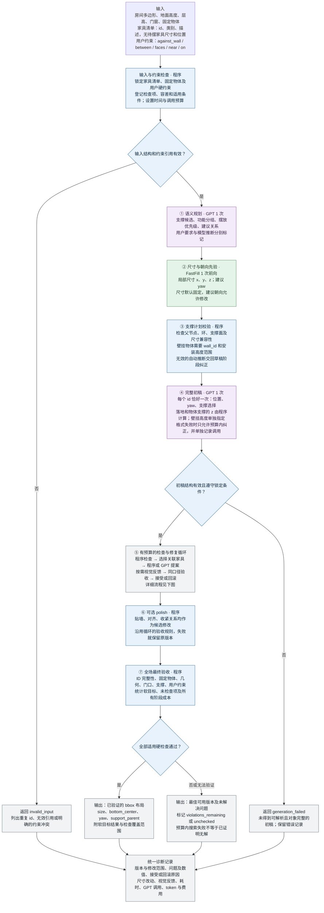
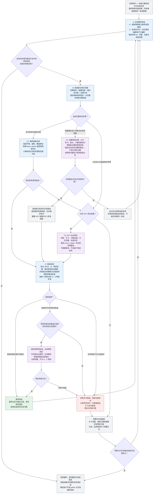

# FastFill Workflow: 按需 Critic 与可验证局部修复

日期：2026-10-25。状态：讨论用设计稿，图中步骤和默认值是建议，不表示当前代码已经实现。

目标是在相同输入下改善布局质量，同时控制端到端时间和调用成本。保留 GPT 语义规划、FastFill 尺寸预测、GPT 初稿的主体，将程序修复和按需视觉反馈放入同一个可验证循环。输出数值布局，不要求生成家具 mesh 或运行物理仿真。

## 1. 总流程

## 2. 检查与修复循环

`K_repair` 表示允许实际发起的 GPT 修复调用数，建议首轮实验取 2 或 3；接受和拒绝都消耗一次。程序搜索、视觉调用和总耗时另设预算。预算允许时，单次失败可换候选或扩大范围，不能无限循环。

视觉审查发现的问题已经被程序规则覆盖时，走普通数值验收；只有无法用现有数值检查验证的视觉改善才需要前后比较。数值检查已通过也可以触发一次预留的整体视觉审查；本轮没有值得修改的问题时，直接结束该分支。图中的每个提案节点都必须先检查自己的剩余预算。

## 3. 评分与提交规则

`H` 和 `S` 越小越好。它们用于控制修复，不是论文最终的质量与效率联合指标。

| 项目 | 定义或规则 |
|---|---|
| 结构有效性 | 家具 id 恰好一次、数值有限、尺寸为正、修改对象在允许范围内；支撑图无环且父对象有效。格式或结构无效的候选直接拒绝。 |
| 硬检查 H | 适用的房间包含、固定障碍物、严重穿插、接触与支撑、层高、用户硬约束、约定的门口净空。记录连续违规程度，并用预先固定的尺度归一化；问题数量另报。 |
| 软检查 S | 用户软要求、适用的功能关系、使用区域可达性、固定的类别先验等。检查集合、权重、容差在实验前固定。 |
| 当前仍有硬错误 | 优先减少 H，允许“同样一处碰撞，但穿透更浅”的进步。原本满足的关键硬条件设保护项，不能用严重的新错误换取其他小改善。H 持平时才比较 S。 |
| 当前已经硬合法 | 候选必须继续满足全部适用硬检查，之后比较 S。硬合法不能被软目标改善抵消。 |
| 纯视觉候选 | H 不退步，S 和重要关系在预定容差内不退步，再使用固定标准做前后视觉比较；不确定则拒绝。此分支可以关闭并单独消融。 |
| 防止无意义移动 | 数值改善需超过固定 epsilon；收益接近时优先移动物体少、偏离当前布局小、尺寸改动少的候选。 |
| 最佳版本 | 在相同程序配置下比较所有已提交版本。数值持平时保留已经通过视觉比较的提交记录；不把不同视角的绝对视觉分数用于跨版本排序。 |

GPT 自己提出的软关系不是新的用户要求，不直接按“没有服从规划”扣硬分。它们用于生成候选；若要用于 S，必须先转成适用性明确的固定检查项。不能修改评分规则后，只重算新版本以制造改善。

程序检查也会有误报：接触容差要覆盖数值舍入；碰撞要区分高度、支撑接触和允许的包含关系；门口和可达性检查要使用合适的净空与使用区域。未知边界、未知地面或不可靠正面要记录检查缺失，不能默认为通过。

## 4. 尺寸与支撑的处理

- 第一轮实验默认 `allow_size_adjustment = false`，保持 FastFill 原始尺寸，便于识别布局修复本身的收益。有限搜索失败时保留失败诊断，不自动缩小家具。
- 尺寸调整作为单独实验分支：仅当修复停滞、预算允许且该开关打开时，生成受类别、描述和训练集先验约束的少量尺寸候选。不能通过反复调用确定性 FastFill 假装得到不同候选。
- 受限尺寸候选仍需经过同一套全场验收。记录调整物体比例、每轴改动、尺寸误差变化以及实际救回的房间数。任何用户明确指定的尺寸必须锁定。
- 用户指定的支撑关系锁定；模型自己推断的支撑可以在修复范围内重选。重新计算子物体相对父物体的位置、旋转和底面高度，并重新验证支撑面积。
- 壁挂对象需要 `wall_id` 和安装高度；物体支撑的接触面只有 bbox 近似时，要明确这一局限，不能把结果标成真实 mesh 物理稳定。
- 尺寸统一为物体局部坐标 `[x, y, z]`。在模型输入输出适配层明确哪一轴表示宽或深，以及物体正面、世界坐标轴和 yaw 的单位；不要混用深宽顺序、角度制和弧度制。

## 5. 预算、停止与输出

建议首轮配置是 `K_repair = 2` 或 `3`，视觉调用总预算为 `0` 或 `2`，后者可供一次诊断和一次前后比较使用。这些数值是待验证的工程起点，不是论文给出的最优参数。

总调用次数按实际记录计算：`N_GPT = N_plan + N_draft + N_repair + N_visual`。正常情况下规划和初稿各 1 次；格式纠正与 API 重试计入各自所属阶段，不能遗漏或重复计数。视觉诊断和视觉比较都计入 `N_visual`。所有实际请求均消耗对应调用预算，并计费和计时。程序搜索也受墙钟时间与候选数量预算约束，必须预留最终验收时间。

达到质量停止条件、预算耗尽或连续若干次没有改善时结束。一次候选被拒绝不必立刻停止；每次重试应改变候选或搜索范围，并记录已尝试动作，避免重复相同失败。

输出每件家具的 `id`、`target_size_local_m`、`bottom_center_m`、`yaw_rad`、`support_parent`，壁挂物体补充墙定位信息。同时分别报告：

- `hard_validity`：适用硬检查是否全部通过。
- `check_coverage`：哪些检查有效、哪些因数据不足而无法执行。
- `soft_quality`：关系、可达性及其他软指标的分项结果。
- `visual_review`：未开启、未检查、已检查及具体反馈。
- `termination_reason`：达标、时间预算、调用预算、搜索预算或连续无改善。
- `history`：草稿、候选、接受与拒绝理由、尺寸变化和各阶段时间及费用。

最终验收必须覆盖 polish 的结果；不能因进入末尾阶段就绕过提交规则。所有“合法”结论只覆盖已执行的 bbox 检查，不代表渲染效果或物理仿真已经通过。

## 6. 与上一版相比

| 上一版设计 | 本版建议 |
|---|---|
| 视觉和程序问题汇总进一个 score | 程序使用固定 H、S；视觉提供建议，纯视觉改动单独验收。 |
| 硬问题只数个数 | 同时保留连续违规程度、保护项和容差。 |
| 每轮都视觉检查 | 程序优先，视觉按需触发，可保留一次最终整体审查。 |
| 只动点名物体及其上面的物体 | 加入碰撞邻居、强关系邻居和支撑子树，必要时扩到功能组。 |
| 一次拒绝就结束 | 在预算内换候选或扩大范围，连续无改善再停止。 |
| 末尾 beam search 作为合法性保证 | 程序搜索是有限预算的修复提案，不承诺一定找到合法解。 |
| polish 后直接输出 | polish 也要验收，最后再做全场检查与状态标记。 |
| 尺寸固定但缺少失败出口 | 默认固定；受限尺寸调整为独立消融，未解决问题如实输出。 |

## 7. 文献依据与待验证部分

| 设计 | 文献可支持的部分 | 本方案自行提出、仍需验证的部分 |
|---|---|---|
| 几何、语义、视觉分工 | [Function2Scene，Table 1 与第 4.2 节](https://arxiv.org/html/2605.30819v1)：按类型和优先级调用检查工具，再迭代修复。 | 在当前工作流中程序优先、视觉按需触发的具体预算和路由。 |
| 局部提案、全场验收、提交或回滚 | [ScenePilot，第 3.3-3.4 节](https://arxiv.org/html/2608.30307v1)：结构化修复动作、局部范围、确定性评分验收与最终全局修复。 | 本方案的 H/S 优先级、保护项和关系邻居范围，不是原文算法的直接复刻。 |
| 关系与几何共同优化 | [LayoutVLM，第 4.3 节](https://arxiv.org/html/2412.02193v3)：对位姿、语义关系和几何目标做连续优化。 | 如何与现有 beam search、FastFill 尺寸及局部动作组合，需要实测。 |
| 视觉分数不能随意混算 | [SceneCritic，第 6.1 节](https://arxiv.org/html/2604.13035v1)：研究不同视角与重复评判导致的 VLM 评分波动。 | 固定视角、成对比较和拒绝不确定候选只是减轻波动的工程策略，不保证判断正确。 |
| FastFill 尺寸优先、受限尺寸回退 | 来自本项目已有尺寸实验及输入契约。 | 没有已核实论文证明该具体组合、触发条件或调整范围最优。 |

论文评估使用预先固定的独立检查配置与必要的盲测人工评判，并报告质量、耗时和成本。不能仅凭内部 H/S 下降认定整个方法更好。

建议首组实验复用相同初稿，比较：程序修复、程序修复加 GPT 局部提案、再加按需视觉 Critic。尺寸回退另做消融。这样可以分别测出语义修复和视觉审查的增益，以及每次额外调用的实际成本。

## 8. 实现状态（2026-10-25）

已在代码中实现（`workflow/critic.py`、`workflow/loop.py`，接入 `pipeline.run_draft_workflow(critic=True)`，默认开启；`critic=False` 复现 v4）：

| 设计项 | 实现 |
|---|---|
| 统一程序评分 H / S | `Critic.assess`：H 为 `Geometry.validate` 的硬违规，每项带连续程度（重叠面积开方、出界面积、支撑高度差、关系距离/角度差）；S 为有上界的软代价：用户软约束（权重 1）、规划关系（0.5，仅建议）、训练集关系模板（0.5，偶数半数据挖出，`critic_templates.json`）、功能面可达（0.5，与 ACC 同口径）、窗前遮挡（0.25） |
| 门口净空 | 改为硬检查，规则与评测 OPC 一致：门前 0.8 m 矩形，落地、≥0.1 m 高、非地毯类、重叠 >0.01 m² 才算挡门；无门扇开启区数据 |
| 验收规则 | `Critic.better`：有硬违规时先比数量、再比程度，新出现 >0.05 m 的硬违规直接拒绝；硬合法版本只接受硬合法候选，再比 S；`EPS_H`/`EPS_S` 防止噪声改进 |
| 修复范围 | 问题物体 + 碰撞邻居 + 关系邻居 + 支撑子树 → 功能组 → 全屋（仅硬问题）；固定物体锁定；每个候选全屋重查 |
| 提案 | 先程序（局部 beam search，模板问题临时转成软关系引导搜索，软问题用较低的移动代价 0.5/m），程序全部失败后才调用 GPT 定点修复（`gpt_repairs` 次，接受或拒绝都计数；可为模型推断的支撑重选父物体，用户给定支撑锁定；父物体移动时子物体随动） |
| 尺寸 | 循环内不缩放（`FixedSizes(allow_shrink=False)`）；受限尺寸调整分支未实现 |
| polish 与最终验收 | polish 每步都用同一 critic 判定（需改善的用 `better`，贴墙/对齐用 `not_worse`）；结束后全屋重评，记录 `unresolved` 与 `status_detail`（hard_valid / violations_remaining） |
| 停止 | 无可尝试问题、连续 `stale_limit` 次无改善、`max_attempts`、程序搜索时间预算 |

尚未实现：视觉诊断 / 前后视觉比较分支（C3、PAIR）、受限尺寸调整、门扇开启区、桌下椅子等合法重叠的豁免、真实 mesh 支撑。

离线回放（test50 的 50 个 v4 草稿，无 API；规划中的 LLM 软关系当时未保存，回放只含功能组关系；`experiments/replay_critic.py`，评测模板为奇数半数据）：

| 版本 | REL ↑ | ACC ↑ | OPC ↓ | COL ↓ | 硬合法房间（旧规则 / 门为硬） | 缩小的物体 | 每房间秒数（中位 / 最大） |
|---|---|---|---|---|---|---|---|
| v4（存档） | 67.9 | 88.3 | 16.8 | 2.1 | 35 / 27 | – | – |
| v4 回放 | 67.9 | 88.3 | 16.8 | 2.4 | 35 / 27 | 2 | 3.0 / 150 |
| critic 回放（仅程序提案） | 73.6 | 93.2 | 6.9 | 1.2 | 35 / 32 | 0 | 8.6 / 186 |
| 真值 | 82.4 | 91.4 | 14.9 | 6.3 | – | – | – |

注意：S 与 REL、ACC 同口径（模板来自不相交的两半训练数据，但同分布），这些指标的提升部分来自"优化了被测量的东西"；论文中需要 critic 未使用的独立指标（设计规则、VLM 成对比较或人评）佐证。GPT 定点修复部分尚未在真实 API 上运行。

### 摆放方式（2026-10-25 起默认"分组摆放"）

`run_draft_workflow(placement="group")`（默认）：按规划的功能组逐组让 LLM 摆放（看得到已摆好的物体和之后要摆的物体尺寸），每组摆完立即检查、只修这一组并冻结；全部摆完后再做一轮整屋 critic 循环（可移动任何物体），然后 polish 与最终验收。`placement="all"` 为一次性整屋摆放（对照）。依据：test50 中 45 个两种方式都跑过的房间（gpt-5.6-sol，各跑一次），分组摆放硬合法 39/45 对 34/45（配对符号检验 p≈0.06），软代价在 27 个房间更低、12 个更高（p≈0.02），剩余硬违规 45 对 145；差距集中在 20 件以上的房间（17/20 对 13/20）。代价约为一次性摆放的 2.2 倍费用、1.9 倍耗时；20 件以下的房间两者质量相当。REL 与 critic 同口径，提升需打折看待；尚缺独立评测（VLM 成对比较 / 人评）。

### 朝向与可达（2026-10-25 加入软约束）

借鉴 SceneSmith 的 `check_facing` 和 `reachability` 两个程序工具，并做了改进。阈值和适用类别都从训练数据的偶数半统计得出（`experiments/mine_wall_rules.py` → `critic_wall_rules.json`，18,880 个房间）。

| 软约束 | 检查内容 | 相对 SceneSmith 的改进 |
|---|---|---|
| `template_faces`（改） | 射线沿正面打中目标的有向包围盒，**或**正面在指向目标中心 45° 以内，任一满足即通过；不满足时，违规大小是还需要转的角度 | 用有向包围盒而不是与坐标轴对齐的盒子；保留 45° 规则，因为真实数据里小目标只看射线的话通过率很低（例如 nightstand→tv stand：射线 0.15，45° 规则 0.93） |
| `wall_back`（新，权重 0.5） | 背面中点离墙不超过 0.15 m，并且正面与墙的内法向夹角不超过 10°；绿植、灯、垃圾桶等没有正面的物体，任一侧面靠墙即可 | 加了距离上限，修掉了"衣柜在房间中间、背朝远墙也算通过"的漏洞；哪些类别要靠墙看数据：真实房间里比例 ≥ 0.8 才检查（衣柜 0.95、床 0.95、电视柜 0.96；沙发 0.70，不检查） |
| `reach`（新，权重 1） | 宽 0.4 m 的人能否从门走到家具的使用面附近（中心距使用面不超过 0.2 + 0.4 m）；座椅和桌子互不阻挡；违规时同时列出堵路的家具 | 不数连通区域，改为判断"从门能否走到"，所以家具背后的小缝不算违规；只检查真实房间里可达率 ≥ 0.9 的 36 个类别。真实房间整体比较拥挤：0.4 m 宽时只有 62% 的房间所有家具都可达 |

**离线回放**：在 48 个房间上，从 C_final 布局出发，用新 critic 只跑程序修复和打磨，不调 GPT。

- 背靠墙违规 39 → 28，可达违规 10 → 6，软约束总代价 33.4 → 26.5；
- 硬合法的房间 42 → 42，没有出现新的硬违规；
- 代价：template_near 违规 12 → 17，挪去靠墙后和搭档家具的距离拉开了一点；
- 用时：每个房间中位数 9.9 s，最长 245 s。
- 同样 48 个房间的真实布局：背靠墙违规 25 个，可达违规 9 个。

**还没做**：在服务器上用新 critic 端到端重跑；用 critic 不看的独立指标（另一个 VLM 或人工）验证这些改动是否真的更好。
